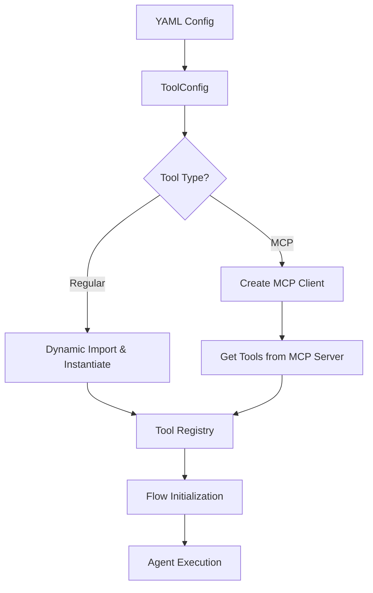

# MCP Tools Integration Plan for Athos Flows

## Overview

This document outlines the plan to add support for MCP (Model Context Protocol) tools in Athos flows. The integration will extend the existing `AthosManager` to create MCP clients and load tools from them, following the pattern demonstrated in `src/athos/examples/servicenow_mcp.py`.

## Current Architecture Analysis

### Existing Components

1. **Tool Loading**: [`AthosManager._load_tool()`](src/athos/core/manager.py:39) dynamically imports and instantiates tools based on [`ToolConfig`](src/athos/config/models.py:24)
2. **Tool Configuration**: [`ToolConfig`](src/athos/config/models.py:24) contains:
   - `name`: Tool identifier
   - `class_name`: Python class name
   - `module_path`: Import path
   - `parameters`: Tool-specific parameters
3. **MCP Example**: [`servicenow_mcp.py`](src/athos/examples/servicenow_mcp.py:8) demonstrates:
   - Creating `StdioServerParameters`
   - Initializing `MCPClient`
   - Getting tools via `mcp_client.get_tools()`
4. **Flow Integration**: Tools are loaded in [`AthosManager._initialize_flows()`](src/athos/core/manager.py:71) and passed to flow constructors

### Dependencies

The project already includes necessary MCP dependencies in [`pyproject.toml`](pyproject.toml:14):
- `mcp>=1.9.0,<2.0.0`
- `smolagents[mcp]>=1.19.0,<2.0.0`

## Proposed Solution Architecture



## Implementation Plan

### Phase 1: Extend Configuration Models

**File**: `src/athos/config/models.py`

#### 1.1 Add New Enums and Classes

```python
from enum import Enum
from typing import Optional, List, Dict, Any
from dataclasses import dataclass, field

class ToolType(Enum):
    """Supported tool types"""
    REGULAR = "regular"
    MCP_STDIO = "mcp_stdio" 
    MCP_SSE = "mcp_sse"

@dataclass
class MCPServerConfig:
    """Configuration for MCP server connection"""
    # For stdio transport
    command: Optional[str] = None
    args: List[str] = field(default_factory=list)
    env: Dict[str, str] = field(default_factory=dict)
    
    # For SSE transport
    url: Optional[str] = None
    headers: Dict[str, str] = field(default_factory=dict)
```

#### 1.2 Extend ToolConfig

```python
@dataclass
class ToolConfig:
    """Configuration for tools (regular and MCP)"""
    name: str
    tool_type: ToolType = ToolType.REGULAR
    
    # Regular tool fields
    class_name: Optional[str] = None
    module_path: Optional[str] = None
    parameters: Dict[str, Any] = field(default_factory=dict)
    
    # MCP tool fields
    mcp_config: Optional[MCPServerConfig] = None
    mcp_tool_name: Optional[str] = None  # Specific tool name from MCP server
```

### Phase 2: Extend AthosManager for MCP Support

**File**: `src/athos/core/manager.py`

#### 2.1 Add MCP Client Management

```python
from mcp import StdioServerParameters, SSEServerParameters
from smolagents.mcp_client import MCPClient
from typing import Dict, List, Union

class AthosManager:
    def __init__(self, config: AthosConfig):
        # ... existing code ...
        self.mcp_clients: Dict[str, MCPClient] = {}
        
    def _create_mcp_client(self, mcp_config: MCPServerConfig) -> MCPClient:
        """Create and cache MCP client based on configuration"""
        # Create cache key based on config
        if mcp_config.command:
            cache_key = f"stdio:{mcp_config.command}"
            if cache_key not in self.mcp_clients:
                params = StdioServerParameters(
                    command=mcp_config.command,
                    args=mcp_config.args,
                    env=mcp_config.env
                )
                self.mcp_clients[cache_key] = MCPClient(params)
        elif mcp_config.url:
            cache_key = f"sse:{mcp_config.url}"
            if cache_key not in self.mcp_clients:
                params = SSEServerParameters(
                    url=mcp_config.url,
                    headers=mcp_config.headers
                )
                self.mcp_clients[cache_key] = MCPClient(params)
        else:
            raise ValueError("MCP config must specify either command or url")
            
        return self.mcp_clients[cache_key]
    
    def _load_mcp_tools(self, tool_config: ToolConfig) -> List[Tool]:
        """Load tools from MCP server"""
        if not tool_config.mcp_config:
            raise ValueError(f"MCP tool {tool_config.name} missing mcp_config")
            
        try:
            mcp_client = self._create_mcp_client(tool_config.mcp_config)
            all_tools = list(mcp_client.get_tools())
            
            # If specific tool name specified, filter for it
            if tool_config.mcp_tool_name:
                filtered_tools = [t for t in all_tools if t.name == tool_config.mcp_tool_name]
                if not filtered_tools:
                    raise ValueError(f"Tool '{tool_config.mcp_tool_name}' not found in MCP server")
                return filtered_tools
            
            return all_tools
            
        except Exception as e:
            logger.error(f"Failed to load MCP tools for {tool_config.name}: {e}")
            raise
```

#### 2.2 Extend Tool Loading Logic

```python
def _load_tool(self, tool_config: ToolConfig) -> Union[Tool, List[Tool]]:
    """Load a tool from configuration (regular or MCP)"""
    if tool_config.name in self.loaded_tools:
        return self.loaded_tools[tool_config.name]
    
    try:
        if tool_config.tool_type == ToolType.REGULAR:
            # Existing regular tool loading logic
            module = __import__(tool_config.module_path, fromlist=[tool_config.class_name])
            tool_class = getattr(module, tool_config.class_name)
            tool_instance = tool_class(**tool_config.parameters)
            self.loaded_tools[tool_config.name] = tool_instance
            logger.info(f"Loaded regular tool: {tool_config.name}")
            return tool_instance
            
        elif tool_config.tool_type in [ToolType.MCP_STDIO, ToolType.MCP_SSE]:
            # New MCP tool loading logic
            mcp_tools = self._load_mcp_tools(tool_config)
            
            # Cache tools individually
            for tool in mcp_tools:
                cache_key = f"{tool_config.name}:{tool.name}"
                self.loaded_tools[cache_key] = tool
                
            logger.info(f"Loaded {len(mcp_tools)} MCP tools for: {tool_config.name}")
            return mcp_tools if len(mcp_tools) > 1 else mcp_tools[0]
            
        else:
            raise ValueError(f"Unknown tool type: {tool_config.tool_type}")
            
    except Exception as e:
        logger.error(f"Failed to load tool {tool_config.name}: {e}")
        raise
```

#### 2.3 Update Flow Initialization

```python
def _initialize_flows(self):
    """Initialize all configured execution flows"""
    for name, flow_config in self.config.execution_flows.items():
        model = self.models[flow_config.model]
        
        if flow_config.type == ExecutionFlowType.CHATBOT:
            flow = ChatbotFlow(model, flow_config.system_prompt)
        
        elif flow_config.type == ExecutionFlowType.AGENT:
            tools = []
            for tool_name in flow_config.tools:
                logger.info(f"Loading tool {tool_name}")
                tool_config = self.config.tools[tool_name]
                loaded_tool = self._load_tool(tool_config)
                
                # Handle both single tools and lists of tools (from MCP)
                if isinstance(loaded_tool, list):
                    tools.extend(loaded_tool)
                else:
                    tools.append(loaded_tool)
            
            flow = AgentFlow(model, tools, flow_config.agent_type.value)
                
            logger.info(f"Initialized {flow_config.type.value}: {name} with {len(tools)} tools")
        
        # ... rest of existing flow initialization logic ...
```

#### 2.4 Add Cleanup Method

```python
def close(self):
    """Clean up MCP clients and other resources"""
    for client in self.mcp_clients.values():
        try:
            # Close MCP client connections
            if hasattr(client, 'close'):
                client.close()
        except Exception as e:
            logger.warning(f"Error closing MCP client: {e}")
    
    self.mcp_clients.clear()
```

### Phase 3: Configuration Integration

#### 3.1 Update YAML Configuration

**File**: `config/config.yaml`

Add example MCP tool configurations:

```yaml
tools:
  # Existing regular tools
  websearch:
    tool_type: "regular"  # Optional, defaults to regular
    class_name: "DuckDuckGoSearchTool"
    module_path: "smolagents.default_tools"
    parameters: {}
    
  webvisit:
    tool_type: "regular"
    class_name: "VisitWebpageTool"
    module_path: "smolagents.default_tools"
    parameters: {}
  
  # New MCP stdio tool - loads all tools from server
  servicenow_mcp:
    tool_type: "mcp_stdio"
    mcp_config:
      command: "servicenow-mcp"
      env:
        SERVICENOW_INSTANCE_URL: "${SERVICENOW_INSTANCE_URL}"
        SERVICENOW_USERNAME: "${SERVICENOW_USERNAME}"
        SERVICENOW_PASSWORD: "${SERVICENOW_PASSWORD}"
        SERVICENOW_AUTH_TYPE: "${SERVICENOW_AUTH_TYPE}"
  
  # MCP stdio tool - loads specific tool only
  servicenow_incidents:
    tool_type: "mcp_stdio"
    mcp_config:
      command: "servicenow-mcp"
      env:
        SERVICENOW_INSTANCE_URL: "${SERVICENOW_INSTANCE_URL}"
        SERVICENOW_USERNAME: "${SERVICENOW_USERNAME}"
        SERVICENOW_PASSWORD: "${SERVICENOW_PASSWORD}"
    mcp_tool_name: "create_incident"
  
  # MCP SSE tool example
  remote_mcp_service:
    tool_type: "mcp_sse"
    mcp_config:
      url: "https://mcp-server.example.com/sse"
      headers:
        Authorization: "Bearer ${MCP_API_TOKEN}"
        Content-Type: "application/json"

execution_flows:
  # Flow using both regular and MCP tools
  mixed_agent:
    type: "agent"
    agent_type: "tool_calling"
    model: "gpt_4o"
    tools: ["websearch", "webvisit", "servicenow_mcp"]
  
  # Flow using only MCP tools
  servicenow_agent:
    type: "agent"
    agent_type: "code"
    model: "cborg_coder"
    tools: ["servicenow_incidents"]
```

#### 3.2 Backward Compatibility

- Existing tool configurations without `tool_type` default to `ToolType.REGULAR`
- All existing flows continue to work unchanged
- Regular tools and MCP tools can be mixed in the same flow

### Phase 4: Error Handling and Validation

#### 4.1 Configuration Validation

Add validation in `ConfigLoader`:

```python
def _validate_tool_config(self, tool_config: ToolConfig):
    """Validate tool configuration"""
    if tool_config.tool_type == ToolType.REGULAR:
        if not tool_config.class_name or not tool_config.module_path:
            raise ValueError(f"Regular tool {tool_config.name} missing class_name or module_path")
    
    elif tool_config.tool_type in [ToolType.MCP_STDIO, ToolType.MCP_SSE]:
        if not tool_config.mcp_config:
            raise ValueError(f"MCP tool {tool_config.name} missing mcp_config")
        
        if tool_config.tool_type == ToolType.MCP_STDIO and not tool_config.mcp_config.command:
            raise ValueError(f"MCP stdio tool {tool_config.name} missing command")
        
        if tool_config.tool_type == ToolType.MCP_SSE and not tool_config.mcp_config.url:
            raise ValueError(f"MCP SSE tool {tool_config.name} missing url")
```

#### 4.2 Runtime Error Handling

- Connection failures: Log error and continue with available tools
- Authentication errors: Clear error messages with configuration hints
- Tool not found: Specific error when `mcp_tool_name` doesn't exist
- Server unavailable: Graceful degradation with retry logic

### Phase 5: Testing Strategy

#### 5.1 Unit Tests

**File**: `tests/test_mcp_integration.py`

```python
def test_mcp_tool_config_validation():
    """Test MCP tool configuration validation"""
    
def test_mcp_client_creation():
    """Test MCP client creation and caching"""
    
def test_mcp_tool_loading():
    """Test loading tools from MCP server"""
    
def test_mixed_tool_flows():
    """Test flows with both regular and MCP tools"""
```

#### 5.2 Integration Tests

- Mock MCP servers for testing
- End-to-end flow execution with MCP tools
- Configuration loading and validation
- Error scenarios and recovery

### Phase 6: Documentation Updates

#### 6.1 Configuration Documentation

- Add MCP tool configuration examples
- Document environment variable usage
- Provide troubleshooting guide

#### 6.2 API Documentation

- Document new `ToolType` enum
- Document `MCPServerConfig` class
- Update `AthosManager` documentation

## Benefits of This Approach

1. **Simplicity**: Extends existing patterns without major architectural changes
2. **Backward Compatibility**: Existing configurations continue to work unchanged
3. **Flexibility**: Supports both stdio and SSE MCP transports
4. **Efficiency**: MCP clients are cached and reused
5. **Error Handling**: Graceful degradation when MCP servers are unavailable
6. **Configuration**: Uses familiar YAML configuration patterns
7. **Mixed Usage**: Regular and MCP tools can be used together in flows

## Implementation Considerations

### Performance
- Cache MCP clients to avoid repeated connection overhead
- Cache loaded tools to avoid repeated server calls
- Consider connection pooling for high-traffic scenarios

### Security
- Secure handling of credentials via environment variables
- Validate MCP server certificates for SSE connections
- Sanitize environment variables in logs

### Reliability
- Implement connection retry logic with exponential backoff
- Handle network timeouts gracefully
- Provide fallback behavior when MCP servers are unavailable

### Monitoring
- Comprehensive logging for MCP connection events
- Metrics for MCP tool usage and performance
- Health checks for MCP server connectivity

## Migration Path

1. **Phase 1**: Implement core MCP support with backward compatibility
2. **Phase 2**: Add example configurations and documentation
3. **Phase 3**: Migrate existing MCP examples to use new configuration
4. **Phase 4**: Add advanced features (connection pooling, health checks)

## Future Enhancements

1. **Dynamic Tool Discovery**: Automatically discover and register MCP tools
2. **Tool Versioning**: Support for MCP tool versioning and updates
3. **Load Balancing**: Distribute MCP tool calls across multiple servers
4. **Monitoring Dashboard**: Web interface for MCP server status and metrics
5. **Tool Marketplace**: Registry of available MCP servers and tools

## Conclusion

This plan provides a comprehensive approach to integrating MCP tools into Athos flows while maintaining simplicity and backward compatibility. The implementation follows existing patterns and extends them naturally to support MCP servers alongside regular tools.