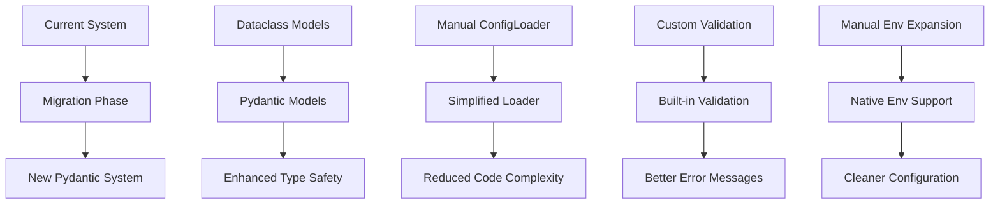

# ATHOS Configuration Migration Plan: Dataclasses to Pydantic

## Migration Overview

**Objective**: Complete migration from dataclasses to Pydantic models in a single phase  
**Scope**: Replace all configuration models and simplify the configuration loading system  
**Timeline**: Single development cycle with comprehensive testing  
**Approach**: Complete migration - replace all dataclasses with Pydantic models at once

## Current System Analysis

### Current Architecture
- **Configuration Models**: Dataclasses in [`src/athos/config/models.py`](../src/athos/config/models.py)
- **Configuration Loading**: Manual parsing in [`src/athos/config/__init__.py`](../src/athos/config/__init__.py)
- **Validation**: Custom validation logic (~159 lines)
- **Environment Variables**: Custom regex-based expansion
- **Usage**: [`AthosManager`](../src/athos/core/manager.py) and examples

### Current Issues
1. **Manual Validation**: Error-prone custom validation in `ConfigLoader._validate_config()`
2. **No Runtime Type Checking**: Type errors discovered only when accessing configurations
3. **Complex Environment Handling**: Custom regex parsing in `_expand_env_var()`
4. **Limited Error Messages**: Generic error messages, difficult to trace to specific fields
5. **Code Duplication**: Repetitive parsing logic for each configuration section

## Migration Architecture



## Phase 1: Dependencies & Setup

### 1.1 Update Dependencies
**File**: `pyproject.toml`

```toml
dependencies = [
    "openai>=1.0.0,<2.0.0",
    "openai-agents>=0.0.19,<0.1.0",
    "mcp>=1.9.0,<2.0.0",
    "smolagents[mcp]>=1.19.0,<2.0.0",
    "duckduckgo_search",
    "markdownify",
    "pydantic>=2.0.0,<3.0.0",  # NEW
    "pydantic-settings>=2.0.0,<3.0.0",  # NEW - for env var handling
]

[project.optional-dependencies]
dev = [
    "pytest>=8.0.0,<9.0.0",
    "pytest-asyncio>=0.21.0,<1.0.0",
    "pydantic[email]>=2.0.0,<3.0.0",  # NEW - for additional validators
]
```

### 1.2 Installation Command
```bash
pip install "pydantic>=2.0.0,<3.0.0" "pydantic-settings>=2.0.0,<3.0.0"
```

## Phase 2: Model Migration

### 2.1 New Pydantic Models
**File**: `src/athos/config/models.py`

Replace existing dataclasses with enhanced Pydantic models:

```python
from enum import Enum
from typing import Dict, List, Any, Optional, Union
from pathlib import Path
from pydantic import BaseModel, Field, field_validator, model_validator, ConfigDict
from pydantic_settings import BaseSettings

class ExecutionFlowType(str, Enum):
    """Supported execution flow types"""
    CHATBOT = "chatbot"
    AGENT = "agent"
    PROMPT_CHAIN = "prompt_chain"

class MCPType(str, Enum):
    """Supported MCP server types"""
    MCP_STDIO = "mcp_stdio"
    MCP_SSE = "mcp_sse"

class ModelConfig(BaseModel):
    """Configuration for AI models"""
    model_config = ConfigDict(extra='forbid')
    
    name: str
    model_id: str
    api_key: Optional[str] = Field(default=None, description="API key for model access")
    api_base: Optional[str] = Field(default=None, description="Base URL for API")
    temperature: float = Field(default=0.7, ge=0.0, le=2.0, description="Model temperature")
    max_tokens: int = Field(default=1024, gt=0, description="Maximum tokens to generate")
    system_prompt: Optional[str] = Field(default=None, description="System prompt for model")
    
    @field_validator('api_base')
    @classmethod
    def validate_api_base(cls, v: Optional[str]) -> Optional[str]:
        if v and not v.startswith(('http://', 'https://')):
            raise ValueError('api_base must be a valid HTTP/HTTPS URL')
        return v

class MCPServerConfig(BaseModel):
    """Configuration for MCP server connection"""
    model_config = ConfigDict(extra='forbid')
    
    name: str
    mcp_type: MCPType
    # For stdio transport
    command: Optional[str] = Field(default=None, description="Command to execute for stdio MCP")
    args: List[str] = Field(default_factory=list, description="Arguments for stdio command")
    env: Dict[str, str] = Field(default_factory=dict, description="Environment variables")
    
    # For SSE transport
    url: Optional[str] = Field(default=None, description="URL for SSE MCP server")
    headers: Dict[str, str] = Field(default_factory=dict, description="HTTP headers for SSE")
    
    @model_validator(mode='after')
    def validate_mcp_config(self):
        if self.mcp_type == MCPType.MCP_STDIO and not self.command:
            raise ValueError(f"MCP stdio server '{self.name}' requires command")
        if self.mcp_type == MCPType.MCP_SSE and not self.url:
            raise ValueError(f"MCP SSE server '{self.name}' requires url")
        return self
    
    @field_validator('url')
    @classmethod
    def validate_url(cls, v: Optional[str]) -> Optional[str]:
        if v and not v.startswith(('http://', 'https://')):
            raise ValueError('url must be a valid HTTP/HTTPS URL')
        return v

class ToolConfig(BaseModel):
    """Configuration for regular tools only"""
    model_config = ConfigDict(extra='forbid')
    
    name: str
    class_name: str = Field(description="Python class name for the tool")
    module_path: str = Field(description="Python module path containing the tool class")
    parameters: Dict[str, Any] = Field(default_factory=dict, description="Tool initialization parameters")
    
    @field_validator('module_path')
    @classmethod
    def validate_module_path(cls, v: str) -> str:
        if not v or '.' not in v:
            raise ValueError('module_path must be a valid Python module path')
        return v

class ExecutionFlowConfig(BaseModel):
    """Configuration for execution flows"""
    model_config = ConfigDict(extra='forbid')
    
    name: str
    type: ExecutionFlowType
    model: str = Field(description="Reference to model configuration")
    mcp_servers: List[str] = Field(default_factory=list, description="List of MCP server names")
    tools: List[str] = Field(default_factory=list, description="List of tool names")
    prompt_chain: Optional[List[Dict[str, str]]] = Field(default=None, description="Prompt chain configuration")
    system_prompt: Optional[str] = Field(default=None, description="System prompt override")
    max_iterations: int = Field(default=10, gt=0, description="Maximum execution iterations")

class AthosConfig(BaseSettings):
    """Main ATHOS configuration with environment variable support"""
    model_config = ConfigDict(
        extra='forbid',
        env_file='.env',
        env_file_encoding='utf-8',
        case_sensitive=True
    )
    
    models: Dict[str, ModelConfig] = Field(default_factory=dict, description="Model configurations")
    tools: Dict[str, ToolConfig] = Field(default_factory=dict, description="Tool configurations")
    mcp_servers: Dict[str, MCPServerConfig] = Field(default_factory=dict, description="MCP server configurations")
    execution_flows: Dict[str, ExecutionFlowConfig] = Field(default_factory=dict, description="Execution flow configurations")
    hpc_cluster_config: Optional[Dict[str, Any]] = Field(default=None, description="HPC cluster configuration")
    logging_config: Optional[Dict[str, Any]] = Field(default=None, description="Logging configuration")
    
    @model_validator(mode='after')
    def validate_references(self):
        """Validate that execution flows reference valid models, tools, and MCP servers"""
        for flow_name, flow_config in self.execution_flows.items():
            # Validate model reference
            if flow_config.model not in self.models:
                raise ValueError(f"Flow '{flow_name}' references unknown model '{flow_config.model}'")
            
            # Validate MCP server references
            for mcp_name in flow_config.mcp_servers:
                if mcp_name not in self.mcp_servers:
                    raise ValueError(f"Flow '{flow_name}' references unknown MCP server '{mcp_name}'")
            
            # Validate tool references
            for tool_name in flow_config.tools:
                if tool_name not in self.tools:
                    raise ValueError(f"Flow '{flow_name}' references unknown tool '{tool_name}'")
        
        return self
```

### 2.2 Environment Variable Configuration
**New File**: `src/athos/config/env_config.py`

```python
from typing import Optional
from pydantic import Field
from pydantic_settings import BaseSettings

class EnvironmentConfig(BaseSettings):
    """Environment-specific configuration with automatic loading"""
    
    # API Keys
    hf_api_key: Optional[str] = Field(default=None, env='HF_API_KEY')
    cborg_api_key: Optional[str] = Field(default=None, env='CBORG_API_KEY')
    cborg_api_url: Optional[str] = Field(default=None, env='CBORG_API_URL')
    
    # ServiceNow Configuration
    servicenow_instance_url: Optional[str] = Field(default=None, env='SERVICENOW_INSTANCE_URL')
    servicenow_username: Optional[str] = Field(default=None, env='SERVICENOW_USERNAME')
    servicenow_password: Optional[str] = Field(default=None, env='SERVICENOW_PASSWORD')
    
    class Config:
        env_file = '.env'
        case_sensitive = False
```

## Phase 3: Configuration Loader Simplification

### 3.1 Simplified ConfigLoader
**File**: `src/athos/config/__init__.py`

**Current Complexity**: 159 lines with manual parsing and validation  
**New Simplified Version**: ~40 lines

```python
import yaml
from pathlib import Path
from typing import Union, Dict, Any
from pydantic import ValidationError

from athos.config.models import (
    AthosConfig,
    ModelConfig,
    ToolConfig,
    MCPServerConfig,
    ExecutionFlowConfig,
    ExecutionFlowType,
    MCPType
)
from athos.config.env_config import EnvironmentConfig

class ConfigLoader:
    """Simplified configuration loader using Pydantic"""
    
    @staticmethod
    def load_config(config_path: Union[str, Path]) -> AthosConfig:
        """Load and validate configuration from YAML file"""
        config_path = Path(config_path)
        if not config_path.exists():
            raise FileNotFoundError(f"Configuration file not found: {config_path}")
        
        # Load YAML data
        with open(config_path, 'r') as f:
            config_data = yaml.safe_load(f) or {}
        
        # Load environment variables
        env_config = EnvironmentConfig()
        
        # Expand environment variables in config data
        config_data = ConfigLoader._expand_env_vars(config_data, env_config)
        
        try:
            # Let Pydantic handle parsing and validation
            return AthosConfig.model_validate(config_data)
        except ValidationError as e:
            raise ValueError(f"Configuration validation failed: {e}")
    
    @staticmethod
    def _expand_env_vars(data: Any, env_config: EnvironmentConfig) -> Any:
        """Recursively expand environment variables in configuration data"""
        if isinstance(data, dict):
            return {k: ConfigLoader._expand_env_vars(v, env_config) for k, v in data.items()}
        elif isinstance(data, list):
            return [ConfigLoader._expand_env_vars(item, env_config) for item in data]
        elif isinstance(data, str) and data.startswith('${') and data.endswith('}'):
            env_var = data[2:-1].lower()  # Remove ${ and }
            env_value = getattr(env_config, env_var, None)
            if env_value is None:
                raise ValueError(f"Configuration environment variable '{data[2:-1]}' is not set")
            return env_value
        return data
```

**Complexity Reduction**:
- **Before**: 159 lines with manual parsing for each config section
- **After**: ~40 lines with Pydantic handling validation
- **Removed Functions**: `_parse_config()`, `_validate_config()`, `_validate_mcp_config()`, `_validate_tool_config()`

## Phase 4: Update Imports and Usage

### 4.1 Core Manager Updates
**File**: `src/athos/core/manager.py`

**Changes Required**: None - the public API remains the same
- Import statements remain identical
- Usage patterns remain identical  
- Enhanced error messages from Pydantic validation

### 4.2 Examples Updates
**Files**: All files in `src/athos/examples/`

**Changes Required**: None - the public API remains the same

## Phase 5: Test Migration

### 5.1 Update Existing Tests
**File**: `tests/test_config_loader.py`

Replace manual validation tests with Pydantic-based tests:

```python
import pytest
from pydantic import ValidationError
from athos.config import ConfigLoader
from athos.config.models import AthosConfig, ExecutionFlowType
from athos.config.env_config import EnvironmentConfig

def test_expand_env_var_success(monkeypatch):
    """Test environment variable expansion through Pydantic settings"""
    monkeypatch.setenv('CBORG_API_KEY', 'test_key')
    env_config = EnvironmentConfig()
    config_data = {
        'models': {
            'm1': {
                'model_id': 'test/model',
                'api_key': '${CBORG_API_KEY}'
            }
        }
    }
    expanded = ConfigLoader._expand_env_vars(config_data, env_config)
    assert expanded['models']['m1']['api_key'] == 'test_key'

def test_expand_env_var_missing(monkeypatch):
    """Test missing environment variable handling"""
    monkeypatch.delenv('NOT_SET', raising=False)
    env_config = EnvironmentConfig()
    with pytest.raises(ValueError, match="Configuration environment variable 'NOT_SET' is not set"):
        ConfigLoader._expand_env_vars('${NOT_SET}', env_config)

def test_parse_config_minimal(monkeypatch):
    """Test minimal configuration parsing with Pydantic"""
    monkeypatch.setenv('CBORG_API_KEY', 'key123')
    config_data = {
        'models': {
            'm1': {
                'model_id': 'id1',
                'api_key': '${CBORG_API_KEY}',
                'api_base': 'https://api.example.com'
            }
        },
        'tools': {
            't1': {
                'class_name': 'TestClass',
                'module_path': 'test.module',
                'parameters': {'p': 1}
            }
        },
        'execution_flows': {
            'f1': {
                'type': 'chatbot',
                'model': 'm1',
                'system_prompt': 'hello',
                'max_iterations': 5
            }
        }
    }
    
    # Expand environment variables
    env_config = EnvironmentConfig()
    expanded_data = ConfigLoader._expand_env_vars(config_data, env_config)
    
    # Validate with Pydantic
    cfg = AthosConfig.model_validate(expanded_data)
    
    # Validate types and values
    assert isinstance(cfg, AthosConfig)
    
    # Model config
    m1 = cfg.models.get('m1')
    assert m1.model_id == 'id1'
    assert m1.api_key == 'key123'
    assert m1.api_base == 'https://api.example.com'
    
    # Tool config
    t1 = cfg.tools.get('t1')
    assert t1.class_name == 'TestClass'
    assert t1.module_path == 'test.module'
    assert t1.parameters == {'p': 1}
    
    # Flow config
    f1 = cfg.execution_flows.get('f1')
    assert f1.name == 'f1'
    assert f1.type == ExecutionFlowType.CHATBOT
    assert f1.model == 'm1'
    assert f1.system_prompt == 'hello'
    assert f1.max_iterations == 5

def test_validation_error_handling():
    """Test Pydantic validation error handling"""
    config_data = {
        'models': {
            'm1': {
                'model_id': 'test/model',
                'temperature': 5.0  # Invalid: > 2.0
            }
        }
    }
    with pytest.raises(ValueError, match="Configuration validation failed"):
        AthosConfig.model_validate(config_data)

def test_cross_field_validation():
    """Test cross-field validation (flow references unknown model)"""
    config_data = {
        'models': {'m1': {'model_id': 'test/model'}},
        'execution_flows': {
            'f1': {
                'type': 'chatbot',
                'model': 'unknown_model'  # Invalid reference
            }
        }
    }
    with pytest.raises(ValueError, match="references unknown model"):
        AthosConfig.model_validate(config_data)

def test_load_config_file_not_found():
    """Test file not found error"""
    with pytest.raises(FileNotFoundError):
        ConfigLoader.load_config('nonexistent_file.yaml')

def test_load_config_minimal_file(tmp_path):
    """Test loading minimal configuration file"""
    cfg_file = tmp_path / 'empty.yaml'
    cfg_file.write_text('{}')
    cfg = ConfigLoader.load_config(str(cfg_file))
    assert hasattr(cfg, 'models') and cfg.models == {}
    assert hasattr(cfg, 'tools') and cfg.tools == {}
    assert hasattr(cfg, 'execution_flows') and cfg.execution_flows == {}
```

### 5.2 New Pydantic-Specific Tests
**New File**: `tests/test_pydantic_config.py`

```python
import pytest
from pydantic import ValidationError
from athos.config.models import ModelConfig, MCPServerConfig, ToolConfig, AthosConfig, MCPType

def test_model_config_validation():
    """Test ModelConfig field validation"""
    # Valid config
    config = ModelConfig(name="test", model_id="test/model")
    assert config.temperature == 0.7  # Default value
    assert config.max_tokens == 1024  # Default value
    
    # Invalid temperature (too high)
    with pytest.raises(ValidationError) as exc_info:
        ModelConfig(name="test", model_id="test/model", temperature=3.0)
    assert "less than or equal to 2" in str(exc_info.value)
    
    # Invalid temperature (negative)
    with pytest.raises(ValidationError) as exc_info:
        ModelConfig(name="test", model_id="test/model", temperature=-1.0)
    assert "greater than or equal to 0" in str(exc_info.value)
    
    # Invalid API base
    with pytest.raises(ValidationError) as exc_info:
        ModelConfig(name="test", model_id="test/model", api_base="invalid-url")
    assert "must be a valid HTTP/HTTPS URL" in str(exc_info.value)
    
    # Valid API base
    config = ModelConfig(name="test", model_id="test/model", api_base="https://api.example.com")
    assert config.api_base == "https://api.example.com"

def test_mcp_server_validation():
    """Test MCPServerConfig validation"""
    # Valid stdio config
    config = MCPServerConfig(
        name="test", 
        mcp_type=MCPType.MCP_STDIO, 
        command="python"
    )
    assert config.mcp_type == MCPType.MCP_STDIO
    assert config.command == "python"
    
    # Invalid: stdio without command
    with pytest.raises(ValidationError) as exc_info:
        MCPServerConfig(name="test", mcp_type=MCPType.MCP_STDIO)
    assert "requires command" in str(exc_info.value)
    
    # Valid SSE config
    config = MCPServerConfig(
        name="test", 
        mcp_type=MCPType.MCP_SSE, 
        url="https://api.example.com"
    )
    assert config.mcp_type == MCPType.MCP_SSE
    assert config.url == "https://api.example.com"
    
    # Invalid: SSE without URL
    with pytest.raises(ValidationError) as exc_info:
        MCPServerConfig(name="test", mcp_type=MCPType.MCP_SSE)
    assert "requires url" in str(exc_info.value)
    
    # Invalid URL format
    with pytest.raises(ValidationError) as exc_info:
        MCPServerConfig(name="test", mcp_type=MCPType.MCP_SSE, url="invalid-url")
    assert "must be a valid HTTP/HTTPS URL" in str(exc_info.value)

def test_tool_config_validation():
    """Test ToolConfig validation"""
    # Valid config
    config = ToolConfig(
        name="test_tool",
        class_name="TestTool",
        module_path="test.tools.module"
    )
    assert config.name == "test_tool"
    assert config.parameters == {}  # Default empty dict
    
    # Invalid module path (no dots)
    with pytest.raises(ValidationError) as exc_info:
        ToolConfig(name="test", class_name="Test", module_path="invalid")
    assert "must be a valid Python module path" in str(exc_info.value)
    
    # Valid with parameters
    config = ToolConfig(
        name="test_tool",
        class_name="TestTool", 
        module_path="test.tools.module",
        parameters={"param1": "value1", "param2": 42}
    )
    assert config.parameters == {"param1": "value1", "param2": 42}

def test_execution_flow_validation():
    """Test ExecutionFlowConfig validation"""
    from athos.config.models import ExecutionFlowConfig, ExecutionFlowType
    
    # Valid config
    config = ExecutionFlowConfig(
        name="test_flow",
        type=ExecutionFlowType.CHATBOT,
        model="test_model"
    )
    assert config.max_iterations == 10  # Default value
    assert config.tools == []  # Default empty list
    assert config.mcp_servers == []  # Default empty list
    
    # Invalid max_iterations (zero)
    with pytest.raises(ValidationError) as exc_info:
        ExecutionFlowConfig(
            name="test_flow",
            type=ExecutionFlowType.CHATBOT,
            model="test_model",
            max_iterations=0
        )
    assert "greater than 0" in str(exc_info.value)

def test_athos_config_cross_validation():
    """Test AthosConfig cross-field validation"""
    # Valid complete config
    config_data = {
        'models': {
            'm1': {'model_id': 'test/model'}
        },
        'tools': {
            't1': {'class_name': 'TestTool', 'module_path': 'test.module'}
        },
        'mcp_servers': {
            'mcp1': {'mcp_type': 'mcp_stdio', 'command': 'python'}
        },
        'execution_flows': {
            'f1': {
                'type': 'agent',
                'agent_type': 'tool_calling',
                'model': 'm1',
                'tools': ['t1'],
                'mcp_servers': ['mcp1']
            }
        }
    }
    config = AthosConfig.model_validate(config_data)
    assert len(config.models) == 1
    assert len(config.tools) == 1
    assert len(config.mcp_servers) == 1
    assert len(config.execution_flows) == 1
    
    # Invalid: flow references unknown model
    invalid_config = config_data.copy()
    invalid_config['execution_flows']['f1']['model'] = 'unknown_model'
    with pytest.raises(ValidationError) as exc_info:
        AthosConfig.model_validate(invalid_config)
    assert "references unknown model" in str(exc_info.value)
    
    # Invalid: flow references unknown tool
    invalid_config = config_data.copy()
    invalid_config['execution_flows']['f1']['tools'] = ['unknown_tool']
    with pytest.raises(ValidationError) as exc_info:
        AthosConfig.model_validate(invalid_config)
    assert "references unknown tool" in str(exc_info.value)
    
    # Invalid: flow references unknown MCP server
    invalid_config = config_data.copy()
    invalid_config['execution_flows']['f1']['mcp_servers'] = ['unknown_mcp']
    with pytest.raises(ValidationError) as exc_info:
        AthosConfig.model_validate(invalid_config)
    assert "references unknown MCP server" in str(exc_info.value)

def test_json_schema_generation():
    """Test automatic JSON schema generation"""
    schema = AthosConfig.model_json_schema()
    assert 'properties' in schema
    assert 'models' in schema['properties']
    assert 'tools' in schema['properties']
    assert 'mcp_servers' in schema['properties']
    assert 'execution_flows' in schema['properties']
    
    # Check that descriptions are included
    models_schema = schema['properties']['models']
    assert 'description' in models_schema

def test_config_serialization():
    """Test configuration serialization capabilities"""
    config_data = {
        'models': {
            'm1': {'model_id': 'test/model', 'temperature': 0.5}
        }
    }
    config = AthosConfig.model_validate(config_data)
    
    # Test JSON serialization
    json_str = config.model_dump_json()
    assert '"model_id": "test/model"' in json_str
    assert '"temperature": 0.5' in json_str
    
    # Test dict serialization
    config_dict = config.model_dump()
    assert config_dict['models']['m1']['model_id'] == 'test/model'
    assert config_dict['models']['m1']['temperature'] == 0.5
```

## Phase 6: Configuration File Updates

### 6.1 Enhanced Configuration Documentation
**File**: `config/config.yaml`

Add validation hints and better documentation:

```yaml
# ATHOS Configuration File
# Enhanced with Pydantic validation and environment variable support

# Model instances that can be used by agents
models:
  gpt_4o:
    model_id: "openai/gpt-4o"  # Required: Model identifier
    api_key: "${CBORG_API_KEY}"  # Automatically loaded from environment
    api_base: "${CBORG_API_URL}"  # Must be valid HTTP/HTTPS URL
    temperature: 0.7  # Range: 0.0-2.0, controls randomness
    max_tokens: 2048  # Must be > 0, maximum tokens to generate
    # system_prompt: "Optional system prompt override"

  cborg_chat:
    model_id: "lbl/cborg-chat:latest"
    api_key: "${CBORG_API_KEY}"
    api_base: "${CBORG_API_URL}"
    temperature: 0.7  # Validated: 0.0 <= temperature <= 2.0
    max_tokens: 2048  # Validated: max_tokens > 0

# MCP servers - Model Context Protocol integrations
mcp_servers:
  filesystem_mcp:
    mcp_type: "mcp_stdio"  # Required for stdio transport
    command: "npx"  # Required: Command to execute
    args: ["-y", "@modelcontextprotocol/server-filesystem", "."]
    # env: {}  # Optional: Environment variables for the process
  
  servicenow_mcp:
    mcp_type: "mcp_stdio"
    command: "python"  # Required for stdio MCP servers
    args: ["-m", "servicenow_mcp"]
    env:  # Environment variables passed to the MCP server
      SERVICENOW_INSTANCE_URL: "${SERVICENOW_INSTANCE_URL}"
      SERVICENOW_USERNAME: "${SERVICENOW_USERNAME}"
      SERVICENOW_PASSWORD: "${SERVICENOW_PASSWORD}"

# Regular tools (non-MCP)
tools:
  websearch:
    class_name: "DuckDuckGoSearchTool"  # Required: Python class name
    module_path: "smolagents.default_tools"  # Required: Must contain dots
    parameters: {}  # Optional: Tool initialization parameters
  
  webvisit:
    class_name: "VisitWebpageTool"
    module_path: "smolagents.default_tools"  # Validated: Must be valid Python module path
    parameters: {}

# Execution flows define complete agent configurations
execution_flows:
  hpc_chatbot:
    type: "chatbot"  # Required: Must be valid ExecutionFlowType
    model: "cborg_chat"  # Required: Must reference existing model
    system_prompt: |  # Optional: Override model's system prompt
      You are an HPC support chatbot. Answer questions about cluster usage, 
      job submission, software modules, and general HPC best practices.
      Keep responses concise but informative.
    # max_iterations: 10  # Optional: Must be > 0, defaults to 10

  web_agent:
    type: "agent"
    agent_type: "tool_calling"
    model: "gpt_4o"  # Validated: Must exist in models section
    tools: ["websearch", "webvisit"]  # Validated: All tools must exist
    # mcp_servers: []  # Optional: List of MCP server names

  filesystem_agent:

    type: "agent"
    agent_type: "tool_calling"
    model: "gpt_4o"  # Validated: Must exist in models section
    mcp_servers: ["filesystem_mcp"]  # Validated: All MCP servers must exist
    system_prompt: "You are a filesystem assistant. Help users navigate and manage files."

  servicenow_agent:
    type: "agent"
    agent_type: "tool_calling"
    model: "cborg_chat"
    mcp_servers: ["servicenow_mcp"]  # Cross-validated against mcp_servers section
    tools: ["websearch"]  # Can combine tools and MCP servers
    max_iterations: 15  # Validated: Must be > 0

# Optional: HPC cluster configuration
# hpc_cluster_config:
#   scheduler: "slurm"
#   default_partition: "regular"
#   max_job_time: "24:00:00"

# Optional: Logging configuration
# logging_config:
#   level: "INFO"
#   format: "%(asctime)s - %(name)s - %(levelname)s - %(message)s"
```

### 6.2 Environment Variables Template
**New File**: `.env.template`

```bash
# ATHOS Environment Variables Template
# Copy to .env and fill in your values

# API Keys
HF_API_KEY=your_huggingface_api_key_here
CBORG_API_KEY=your_cborg_api_key_here
CBORG_API_URL=https://your-cborg-api-url.com

# ServiceNow Configuration (for ServiceNow MCP server)
SERVICENOW_INSTANCE_URL=https://your-instance.service-now.com
SERVICENOW_USERNAME=your_username
SERVICENOW_PASSWORD=your_password

# Optional: Additional API configurations
# OPENAI_API_KEY=your_openai_key_here
# ANTHROPIC_API_KEY=your_anthropic_key_here
```

## Phase 7: Implementation Timeline

### 7.1 Development Schedule

| Phase | Duration | Tasks | Dependencies |
|-------|----------|-------|--------------|
| **Setup** | 1 day | Install Pydantic, update pyproject.toml | None |
| **Models** | 2 days | Convert all dataclasses to Pydantic models | Setup complete |
| **Loader** | 1 day | Simplify ConfigLoader, add environment support | Models complete |
| **Tests** | 2 days | Update existing tests, add Pydantic-specific tests | Loader complete |
| **Integration** | 1 day | Test with existing examples and core manager | Tests passing |
| **Documentation** | 1 day | Update README, add migration notes | Integration complete |

**Total Estimated Time**: 8 development days

### 7.2 Implementation Order

1. **Dependencies First**: Update `pyproject.toml` and install Pydantic
2. **Models Migration**: Replace dataclasses with Pydantic models
3. **Loader Simplification**: Reduce ConfigLoader from 159 to ~40 lines
4. **Test Updates**: Ensure all tests pass with new validation
5. **Integration Testing**: Verify examples and core functionality work
6. **Documentation**: Update user-facing documentation

## Phase 8: Risk Assessment & Mitigation

### 8.1 Potential Risks

| Risk | Impact | Probability | Mitigation Strategy |
|------|--------|-------------|-------------------|
| **Breaking API Changes** | High | Low | Maintain identical public API |
| **Performance Regression** | Medium | Low | Benchmark before/after, Pydantic is typically faster |
| **Environment Variable Issues** | Medium | Medium | Comprehensive testing of env var expansion |
| **Validation Too Strict** | Medium | Medium | Gradual validation tightening, good error messages |
| **Test Coverage Gaps** | Low | Medium | Comprehensive test migration plan |

### 8.2 Rollback Plan

If issues arise during migration:

1. **Git Branch Strategy**: Implement on feature branch `feature/pydantic-migration`
2. **Backup Current System**: Tag current version before migration
3. **Incremental Testing**: Test each phase before proceeding
4. **Quick Rollback**: Revert to tagged version if critical issues found

## Phase 9: Benefits Realization

### 9.1 Immediate Benefits

**Code Quality**:
- **159 → 40 lines**: 75% reduction in ConfigLoader complexity
- **Automatic Validation**: No more manual validation logic
- **Type Safety**: Runtime type checking and coercion
- **Better Error Messages**: Field-specific validation errors

**Developer Experience**:
- **IDE Support**: Better autocomplete and type hints
- **Documentation**: Auto-generated JSON schemas
- **Debugging**: Clear validation error messages with field paths

### 9.2 Long-term Benefits

**Maintainability**:
- **Reduced Bug Surface**: Less custom validation code to maintain
- **Easier Extensions**: Adding new config fields is straightforward
- **Self-Documenting**: Pydantic models serve as living documentation

**Operational Benefits**:
- **Configuration Validation**: Catch errors at startup, not runtime
- **Environment Integration**: Native support for environment variables
- **Serialization**: Built-in JSON/dict serialization for debugging

## Phase 10: Post-Migration Tasks

### 10.1 Documentation Updates

**Files to Update**:
- `README.md`: Update configuration examples
- `docs/configuration.md`: Add Pydantic-specific documentation
- `examples/README.md`: Update example configurations

### 10.2 Monitoring & Validation

**Success Metrics**:
- All existing tests pass
- Configuration loading time (should be similar or faster)
- Error message quality (should be more specific)
- Code coverage maintained or improved

### 10.3 Future Enhancements

**Enabled by Pydantic**:
- **Configuration UI**: Auto-generate web forms from Pydantic models
- **API Integration**: Use same models for REST API validation
- **Advanced Validation**: Custom validators for complex business rules
- **Configuration Migration**: Version-aware configuration upgrades

## Conclusion

This migration plan provides a comprehensive path from the current dataclass-based configuration system to a robust Pydantic-based system. The migration will:

- **Reduce complexity** by 75% (159 → 40 lines in ConfigLoader)
- **Improve reliability** through automatic validation
- **Enhance developer experience** with better error messages and IDE support
- **Maintain backward compatibility** with existing configuration files
- **Enable future enhancements** through Pydantic's rich ecosystem

The single-phase approach ensures a clean migration without the complexity of maintaining two systems simultaneously. With comprehensive testing and a clear rollback plan, this migration represents a significant improvement to the ATHOS configuration system.

---

**Next Steps**: 
1. Review this migration plan
2. Set up development branch: `git checkout -b feature/pydantic-migration`
3. Begin with Phase 1 (Dependencies & Setup)
4. Follow the implementation timeline for systematic migration